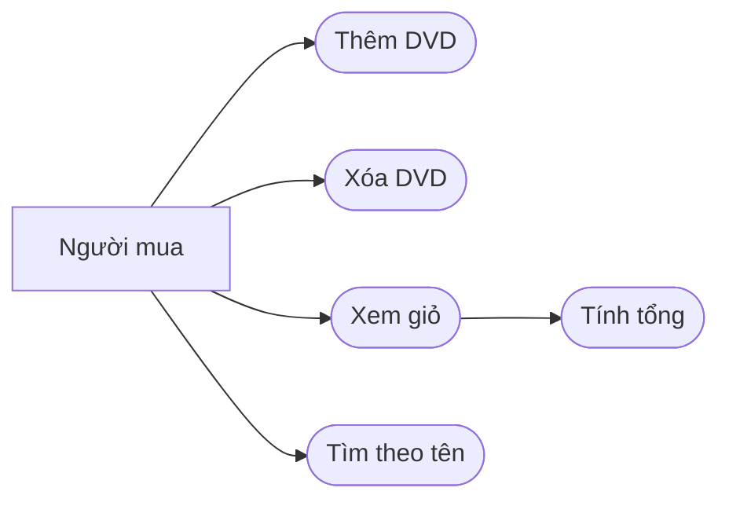

# Use case AIMS-mini

Tác nhân: người mua, tương tác với giỏ và tìm DVD trong danh sách.

Thêm: chọn DVD, gọi add_dvd; giỏ đầy thì từ chối (lỗi biên được sửa ở Lab 03).
Xóa: remove_dvd trả False nếu không có DVD, True nếu xóa được.
Xem giỏ: print_cart hiển thị từng DVD và tổng, hoặc thông báo giỏ rỗng.
Tính tổng: cộng cost của các DVD, hiển thị hai số lẻ.
Tìm kiếm: search_by_title nhận danh sách và từ khóa, trả các DVD có tên chứa từ khóa; tại Lab 02 phân biệt hoa thường.
